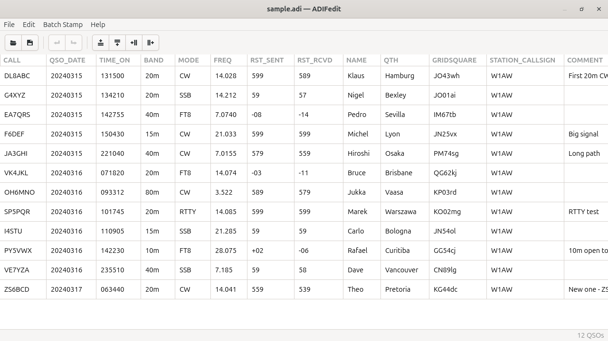
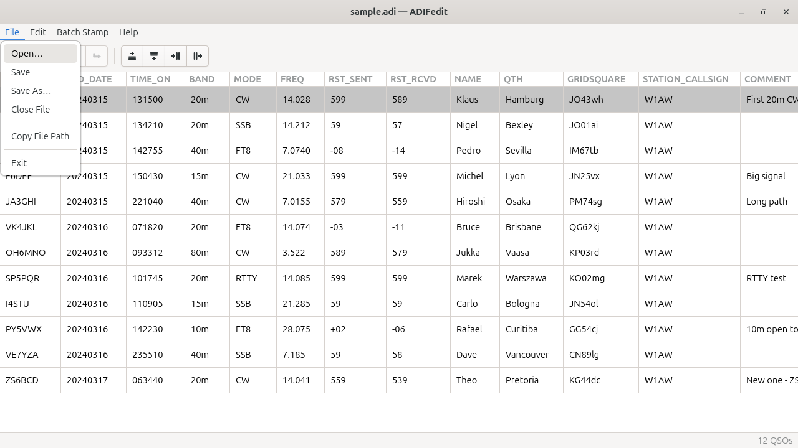
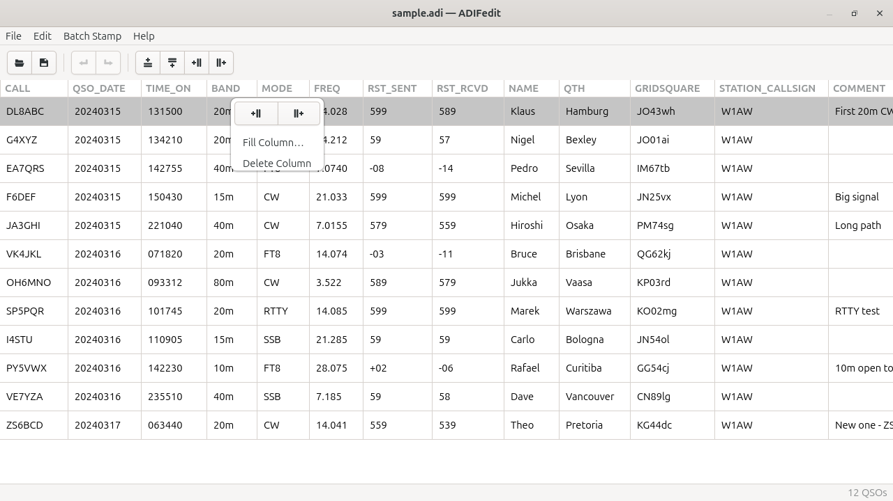
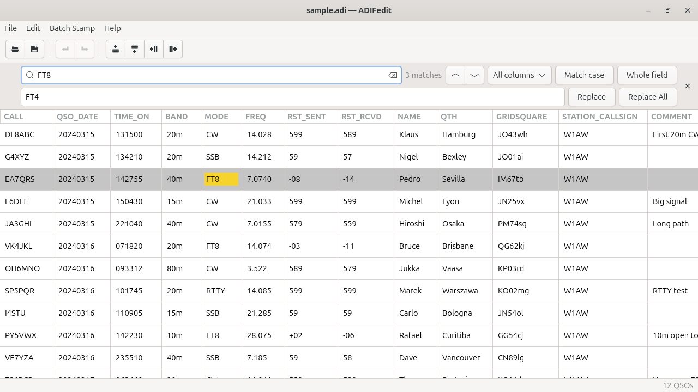
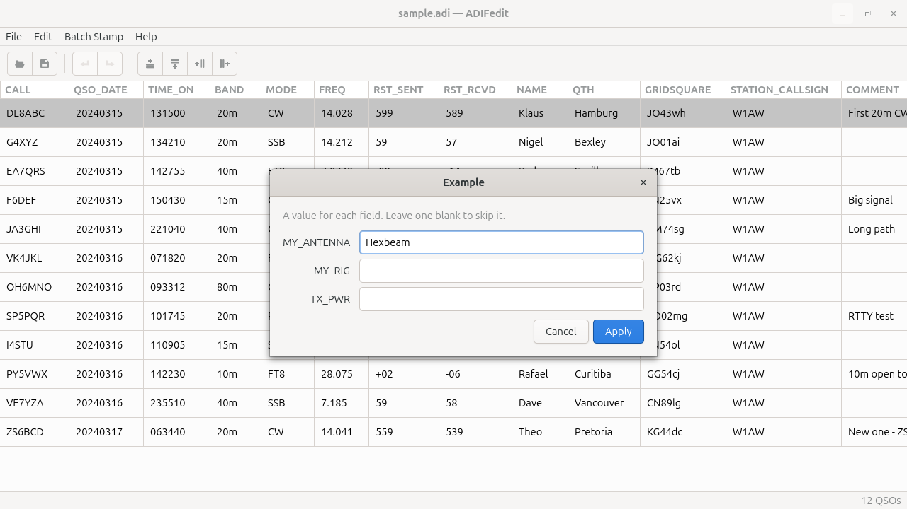

<!--
adifedit - a GTK4 viewer and editor for ham radio ADIF logs.
Copyright (C) 2026 Nicholas Heath
SPDX-License-Identifier: GPL-3.0-or-later
-->

# adifedit

## My experiment with Claude Code.

adifedit began as a way to get to know `Claude Code`.

It isn't meant to be "the perfect way" to handle ADIF logs, nor perfect C
or GTK. It's my experiment in building software with AI and as little
hand-written code as possible, to get a tool I'll actually use. That part
of the experiment is over, so feel free to contribute — with AI, or by
sheer human will and ingenuity.

As with all FOSS, the GPL's warning really is the case:

> This program is distributed in the hope that it will be useful, but
> WITHOUT ANY WARRANTY; without even the implied warranty of
> MERCHANTABILITY or FITNESS FOR A PARTICULAR PURPOSE.

Keep a copy of a log before you edit it. Good luck!

## Purpose and scope

adifedit is for viewing and editing ham radio ADIF logs — and only that.
It opens an `.adi` / `.adif` file, shows every record as a row and every
field as a column, and lets you edit with ease — then writes it back as
plain ADIF. It handles the jobs a logger makes awkward: fixing a wrong
band on forty QSOs, adding one or a group of tags (e.g. `MY_RIG`,
`MY_LAT`, and `MY_LON`) via `Batch Stamp` to a log, dropping junk
columns an importer created, or just seeing what is actually in the file.

It is deliberately **not** a logger, an award tracker, a statistics
generator, a QSL / LoTW uploader, a callsign lookup, or rig control —
those are other programs' jobs. adifedit keeps the Unix habit: do one job
well and add nothing you cannot hand back. No database, no account,
no network, no daemon, no fuss.

## Features

- ✅ View any `.adi` / `.adif` log as an editable grid.
- ✅ Edit any cell in place; insert, delete and fill rows and columns from
  a right-click menu or the toolbar
- ✅ Undo / redo everything (`Ctrl+Z` / `Ctrl+Y`), with multi-step actions
  collapsing to a single step
- ✅ Find and Find & Replace (`Ctrl+F` / `Ctrl+H`) across cell values, all
  columns or one
- ✅ Batch Stamp — write the same set of fields into every record from a
  reusable `.bst` template
- ✅ Rejects non-ASCII/UTF-8 files; opens length-mismatched ones
  best-effort with a warning - each bad field fitted to its data and
  highlighted - and puts effort into fencing the user off from
  overwriting them ([`(parse_warn)`](#reading-and-writing))
- ✅ Saves plain, portable ADIF — blank rows dropped, the source logger
  recorded in the header, the rest of the header and fields' type
  indicators kept as they were
- ✅ Threaded load / save; prompts before you lose unsaved changes, and
  before saving over a log another program (a logger) has changed since
  it was opened
- ✅ Runs on Linux and 64-bit Windows; the portable Windows zip is
  cross-built from Linux ([Windows build](#windows-build))

Planned: importing an ADIF file into the open log, and exporting selected
rows as a new ADIF file. Release history is in
[`CHANGELOG.md`](CHANGELOG.md).



## Menus and controls

* **File** menu -- Open (prompts to save or discard if the current file
  has unsaved changes), Save (`Ctrl+S`; opens Save As for a
  `(parse_warn)` file, and asks first if the file has changed on disk
  since it was opened), Save As, Close File (`Ctrl+W`,
  same prompt; empties the window), Copy File Path (offers to save first
  if there are unsaved changes), Exit

  

* **Edit** menu -- Undo (`Ctrl+Z`) / Redo (`Ctrl+Y` or `Ctrl+Shift+Z`),
  Find (`Ctrl+F`), Find and Replace (`Ctrl+H`); see
  [Find and replace](#find-and-replace)
* **Batch Stamp** menu -- run a saved stamp: prompts for a value per
  field and writes them into every record (one undo step); see
  [Batch stamp files](#batch-stamp-files)
* **Toolbar** -- Open, Save, Undo / Redo, and insert a row above / below
  or a column left / right of the cursor cell
* **Editing a cell** -- click it, press `Enter` / `F2`, or just start
  typing over it (`Backspace` / `Delete` start it empty). `Enter` finishes,
  `Esc` puts the old value back, and moving to another cell keeps the
  edit. Each cell's edit is one undo step.
* **Right-click a cell** -- insert a row above / below or a column left /
  right, Fill Column, Delete Column, Delete Row
* **Right-click a column header** -- the column operations only

  

* **Status bar** -- live QSO count (right)
* **Title bar** -- shows a `•` while there are unsaved changes, and
  `(parse_warn)` after the file name when adifedit won't save over it
* **Help** menu -- a link to the ADIF specification this build targets
  (currently 3.1.7), and **About** (version, git hash, build time in UTC,
  the GTK version + its LGPL notice, copyright, GPL notice)

## Reading and writing

New columns are exported as valid ADIF fields (field-name validation on
input). Empty cells are omitted from the output, so a record with no
value for a field stays blank; a row with no values at all is dropped
from the saved file. A field's type indicator (the `N` in
`<APP_X_PTS:2:N>`) is written back too, one per column: the first one
the file gave that field.

The saved header carries `<PROGRAMID:8>adifedit`, `<PROGRAMVERSION>` (the
release), and `<APP_ADIFEDIT_PROGRAMHASH>` (the build's git short hash, or
`unknown`). If the file came from another logger, its original
`PROGRAMID`/`PROGRAMVERSION` are preserved in `<APP_ADIFEDIT_ORIG_PROG>`
(captured once on first load and never overwritten on re-save).

The rest of the loaded file's header is written back as it was, in its
original order and with any type indicators: `USERDEFn` definitions,
other programs' `APP_` fields, and so on. `CREATED_TIMESTAMP`, if there
was one, is set to the time of the save. The free text before the first
header field is replaced by adifedit's own line.

If the file changes on disk after adifedit opened it (a logger still
writing QSOs to it, or the same file saved from another adifedit
window), Save doesn't overwrite it silently. It asks whether to
**Overwrite**, **Save As** a new file, or **Cancel**.

Files must be ASCII or UTF-8 (field lengths are read as byte counts);
any other encoding is rejected with an explanation. A file whose lengths
don't match its data is still opened, on a best-effort basis, with a
warning to check the records before saving.

**Best-effort** means each field whose declared length doesn't land on
the next tag is fitted to the data that's actually there, rather than
truncated or allowed to swallow the next field. adifedit first reads
the length as a character count (the usual cause: a logger counting
characters, not bytes, so `Metsälä` is written as 7 instead of 9); if
that doesn't land either, the value runs up to the next tag. The warning
says how many fields were fitted and names the first few (`record 3
QTH`), and each one has a **pale yellow background** in the grid until
the file is closed - review those cells before saving. A saved copy
gets correct lengths.

Field names follow the ADIF rules: any printable text without
`, : < > { }` or a leading/trailing space (so `APP_X-Y` and `MY FIELD`
are fine).
A field whose name breaks those rules can't be written back as ADIF, so
it is left out, and the file is opened with the same warning.

**`(parse_warn)`** -- adifedit isn't confident it read such a file
correctly, so writing its interpretation back could silently corrupt the
log. The title bar marks the file `(parse_warn)`, and adifedit won't save
over it: Save (`Ctrl+S`), and the Save button of the unsaved-changes
prompts, open Save As instead, suggesting `<name>-adifedit.<ext>` in the
same folder (`log.adi` -> `log-adifedit.adi`). Choosing the original
file there is refused - through a symlink too. Once saved under a new
name, that copy is adifedit's own output and saves normally; the
original is never touched.

---

## Requirements

| | |
|---|---|
| C compiler | ISO **C11** (GCC 4.9+ / Clang 3.1+ -- effectively any current toolchain); the build is `-pedantic-errors`, so newer-standard or GNU extensions fail |
| Build system | **CMake >= 3.25** + a generator (Make or Ninja) |
| Libraries | **GTK 4.12 or newer** (via `pkg-config`) |
| Tools | `pkg-config`, `glib-compile-resources` (ships with GLib) |
| Optional | `appstreamcli` + `desktop-file-validate` (the metadata tests), clang (the fuzz preset), `cage` (the view test) |

`glib-compile-resources` is required because the application icon, the
toolbar icons and the stylesheet are compiled into the binary as a
GResource (so they show up even when running straight from the build
tree, with nothing installed).

The 4.12 floor is load-bearing: the app uses `gtk_column_view_scroll_to()`
(4.12), plus `GtkUriLauncher` / `GtkFileLauncher` (4.10). Lowering `pkg_check_modules(... gtk4>=4.12)` in
`CMakeLists.txt` means finding replacements for those.

Those are for building on Linux. The Windows zip needs nothing installed
on the Windows side, and building it on Linux needs only `podman`; see
[Windows build](#windows-build).

---

## Installing build dependencies

```sh
./scripts/install-build-deps.sh
```

The script detects your package manager (**apt**, **dnf**, or **pacman**),
installs the matching packages with `sudo`, and prints the build commands.

| Manager | Packages |
|---|---|
| apt | `build-essential gcc cmake pkg-config libgtk-4-dev libglib2.0-dev-bin librsvg2-bin clang clang-format clang-tidy shellcheck appstream desktop-file-utils cage grim podman` |
| dnf | `gcc cmake pkgconf-pkg-config gtk4-devel glib2-devel librsvg2-tools clang clang-tools-extra ShellCheck appstream desktop-file-utils cage grim podman` |
| pacman | `base-devel cmake pkgconf gtk4 glib2 librsvg clang shellcheck appstream desktop-file-utils cage grim podman` |

On any other system, install the equivalents by hand: a C11 compiler,
`cmake` >= 3.25, `pkg-config`, the GTK 4 dev files, `glib-compile-resources`
(usually in the GLib dev package), and `rsvg-convert` (from librsvg). For
the developer workflow you also need `clang-format` / `clang-tidy` /
`shellcheck` (the pre-push checks in [`CONTRIBUTING.md`](CONTRIBUTING.md)),
`clang` (the fuzz preset), `appstreamcli` / `desktop-file-validate` (the
metadata tests), `cage` / `grim` (the headless screenshot scripts) and
`podman` (the [Windows build](#windows-build)). `oxipng` or
`optipng`, if present, are used to recompress generated PNGs.

---

## Building

### With presets (recommended)

`CMakePresets.json` defines these configurations, each in its own build
directory:

| Preset | Build dir | Flags |
|---|---|---|
| `debug` | `build/debug` | `-O0 -g` -- no optimisation, full gdb info |
| `release` | `build/release` | `-O3 -DNDEBUG` + LTO -- no debug info |
| `asan` | `build/asan` | as `debug`, plus AddressSanitizer + UBSan (`ctest --preset asan`) |
| `fuzz` | `build/fuzz` | clang + libFuzzer: builds only the parser fuzz target (see CONTRIBUTING.md "Fuzzing") |
| `windows` | `build/windows` | as `release`, cross-compiled for 64-bit Windows -- only inside the MinGW container (see [Windows build](#windows-build)) |

```sh
# configure + build the debug tree
cmake --preset debug
cmake --build --preset debug

# configure + build the optimised tree
cmake --preset release
cmake --build --preset release
```

List the presets with `cmake --list-presets`. To add your own presets
(e.g. a Ninja generator, a sanitizer build) without touching the tracked
file, create a `CMakeUserPresets.json` next to it.

### Without presets

```sh
cmake -S . -B build            # configures a Debug build by default
cmake --build build            # -> build/adifedit
cmake --build build -j         # parallel
```

To pick a different type explicitly:

```sh
cmake -S . -B build -DCMAKE_BUILD_TYPE=Release
```

### Choosing the compiler

By default CMake uses whatever it finds -- the `CC` environment variable
if set, otherwise `gcc` / `cc` / `clang` on `PATH`. To force one, set
`CC` on the **configure** step and give it its own build directory (the
compiler is baked into the cache, so switching needs a fresh tree):

```sh
CC=clang cmake -S . -B build/clang -DCMAKE_BUILD_TYPE=Debug
cmake --build build/clang
```

`CC` also applies to `cmake --preset debug`, but that preset always
configures `build/debug`; delete it first if it was set up with another
compiler.

gcc and clang diagnose different things, which is the usual reason to
reach for the other one.

### Build types

Single-config generators (Make, Ninja) build exactly one type, fixed at
configure time. adifedit supports three:

| `CMAKE_BUILD_TYPE` | Optimisation | Debug info | Asserts |
|---|---|---|---|
| `Debug` (default) | `-O0` | `-g` | on |
| `Release` | `-O3` + LTO | none | off (`-DNDEBUG`) |
| `RelWithDebInfo` | `-O3` | `-g` | off (`-DNDEBUG`) |

* A bare `cmake -S . -B build` with no `-DCMAKE_BUILD_TYPE` falls back to
  **Debug** (rather than the CMake default of *no* flags at all).
* `MinSizeRel` and any other value are rejected at configure time.
* LTO is enabled for `Release` only, and only if the toolchain supports
  it (checked with `check_ipo_supported`); otherwise it is skipped with a
  status message.
* `-Wall -Wextra -Wshadow -pedantic-errors` is on for every build type
  (our code only; GTK's headers come in as system includes and are
  exempt). Dead code is an error on top: unused functions, variables,
  parameters, labels, values and macros, non-static functions with no
  prototype, and (clang only) unreachable code - see CONTRIBUTING.md
  "Dead code". The generated GResource blob is exempted from
  `-Woverlength-strings` and `-Wunused-macros`.

---

## Running

```sh
./build/debug/adifedit                # from the debug preset
./build/release/adifedit  mylog.adi   # optionally with a file to open
./build/adifedit                      # from a plain `cmake -S . -B build`
```

Pass one or more `.adi` / `.adif` paths to open them on start (this is
also how a file manager launches it); otherwise open a file from
**File -> Open**. `assets/sample.adi` is a small demo log to try it on.

`adifedit --version` prints the release version and the git commit it was
built from (`unknown` if that couldn't be determined); `adifedit --help`
lists the rest.

On Windows, run `bin\adifedit.exe` from the unzipped folder, or drag an
`.adi` file onto it. It's a GUI program with no console, so `--version`
and `--help` print nothing there; **Help -> About** shows the version.

On older or low-powered hardware, if the window is slow to appear, try a
different GTK renderer: `GSK_RENDERER=gl adifedit` or
`GSK_RENDERER=cairo adifedit`. GTK picks one by itself at startup, and it
isn't always the fastest on that machine.

The Windows build defaults to `GSK_RENDERER=cairo`: GTK's GPU renderers
draw a thick black frame around every window and dialog there. Setting
`GSK_RENDERER` yourself (for example `set GSK_RENDERER=gl` in Command
Prompt before starting it) overrides that.

---

## Find and replace

`Ctrl+F` opens the find bar; `Ctrl+H` adds the replace row.



- Searches **cell values** (not column names). ASCII case-insensitive by
  default; toggle **Match case** or **Whole field** (the entire cell
  value, not a substring). The dropdown limits the search to one column.
- `Enter` / the arrows step through matches, wrapping around; the current
  match cell is highlighted and scrolled into view. The bar shows the
  total count.
- **Replace** changes the current match and moves to the next; each press
  is its own undo step.
- **Replace All** changes every match in one pass -- and **one `Ctrl+Z`
  puts them all back** (it is a single undo step), so there is no
  "are you sure?" prompt.

---

## Batch stamp files

A *batch stamp* adds the same set of ADIF fields to every record -- the
ones your logger doesn't write but you want (`MY_RIG`, `MY_ANTENNA`,
`TX_PWR`, ...). Choosing one from the **Batch Stamp** menu prompts for a
value per field; each non-blank value is written into every record that
has any data (fully blank rows are left alone), inserting the column if
it doesn't exist yet. The whole thing is one undo step.



A stamp is a plain-text `.bst` file:

```
# Line 1: the name shown in the Batch Stamp menu.
# The rest: one ADIF field name per line (case-insensitive; stored uppercase).
# Blank lines and lines starting with # are ignored.

Example

MY_ANTENNA
MY_RIG
TX_PWR
```

- Put your own in `~/.local/share/adifedit/stamps/`; the installed
  `example.bst` lives under `<prefix>/share/adifedit/stamps/`. The menu
  shows both, a same-named user file winning. On Windows the user folder
  is `%LOCALAPPDATA%\adifedit\stamps\`, and `example.bst` is in the
  unzipped `share\adifedit\stamps\`.
- **Batch Stamp -> Open Stamps Directory** opens that folder in the file
  manager or copies its path.
- A line that isn't a valid ADIF field name doesn't stop the file from
  appearing, but the stamp won't run until you fix it (it tells you
  which line).

---

## Running the tests

The model layer (`AdifDocument`, the ADIF parser) is split into a
GTK-free static library, `adifcore`, and exercised by headless test
binaries wired to CTest:

```sh
cmake --build build
ctest --test-dir build --output-on-failure
```

No display is needed. Five headless suites, plus one view test and two
metadata checks:

- `test_document.c` — schema/row/column edits, fill, serialisation
  round-trips (including the kept header fields and type indicators),
  the modified flag, undo/redo (coalesced edits, groups, "undo back to
  the saved state"), search & replace, plus parser edge cases,
  `adif_field` name rules, and `AdifRow`.
- `test_batch_stamp.c` — the `.bst` parser and stamp discovery (XDG dirs
  sandboxed to the build tree).
- `test_io.c` — the async load / save wrappers, driven with a `GMainLoop`:
  the changed-on-disk (etag) check, saving through a symlink, and the
  Save As copy-name / same-file helpers.
- `test_known_fields.c` — the built-in list of standard ADIF field names
  (sorted, no duplicates, header-only fields excluded).
- `fuzz_parser.c` (the `fuzz_corpus` test) — replays every file in
  `tests/fuzz_corpus/` through the fuzz target's checks: what adifedit
  saves re-reads with no warning and keeps every value, type indicator
  and header field through a second load and save. The `regress-*` files are inputs the fuzzer once broke.
- `test_table_scroll.c` — the grid in a real window: inserting or deleting
  a column in a table wider than the window keeps the horizontal scroll
  where it was, and deleting the focused cell's column is safe. Runs in
  its own headless `cage` session (`tests/run_headless.sh`); skipped
  without `cage`.
- `metainfo` / `desktop_file` — `appstreamcli validate` and
  `desktop-file-validate` on the installed metadata; registered only
  when those tools are installed.

The same tests also run under AddressSanitizer + UBSan
(`cmake --preset asan && cmake --build --preset asan && ctest --preset asan`).
The same `tests/fuzz_parser.c` is also a libFuzzer target, built by the
`fuzz` preset; see "Fuzzing" in [`CONTRIBUTING.md`](CONTRIBUTING.md).

---

## Installing system-wide

Install from whichever build tree you want to ship (usually `release`):

```sh
sudo cmake --install build/release --strip
```

| Installed file | Location (under the prefix) |
|---|---|
| `adifedit` binary | `bin/` |
| `io.github.nheathlabs.adifedit.desktop` | `share/applications/` |
| `io.github.nheathlabs.adifedit.xml` (MIME type `application/x-adif`) | `share/mime/packages/` |
| `io.github.nheathlabs.adifedit.metainfo.xml` (AppStream, for software centres) | `share/metainfo/` |
| Icon (8 PNG sizes + SVG) | `share/icons/hicolor/<size>/apps/io.github.nheathlabs.adifedit.*` |
| `COPYING` | `share/doc/adifedit/` |

After a normal (non-`DESTDIR`) install the icon, MIME and desktop
databases are refreshed automatically, so `.adi` / `.adif` files get the
adifedit icon and open in it from a file manager.

Useful options:

```sh
# choose the prefix (default: /usr/local)
sudo cmake --install build/release --prefix /usr

# strip symbols from the installed binary
sudo cmake --install build/release --strip

# stage into a package root instead of the live system
DESTDIR="$PWD/pkgroot" cmake --install build/release --prefix /usr
```

### Uninstalling

```sh
sudo cmake --build build/release --target uninstall
```

This removes every file recorded in
`build/release/install_manifest.txt`. Shared directories
(`share/icons/hicolor/*/apps/`, etc.) are left in place because other
applications live there; run
`gtk4-update-icon-cache -f -t <prefix>/share/icons/hicolor` yourself if
you want the removed icons dropped from the cache immediately.

---

## Windows build

adifedit cross-compiles for 64-bit Windows from Linux, using Fedora's
MinGW build of GTK 4 inside a rootless podman container. You don't need
Fedora or Windows on the build machine; you only need podman:

```sh
sudo apt install podman        # once (or dnf / pacman; install-build-deps.sh includes it)
scripts/windows-podman.sh
```

The first run builds the container image (`ci/Containerfile`, packages
listed in `ci/windows-packages.txt`), which takes a few minutes; later
runs reuse it. The output is:

| Output | What it is |
|---|---|
| `build/windows/package/adifedit/` | the bundle: `bin/adifedit.exe`, the GTK DLLs, `share/` (GSettings schemas, icon theme, the starter stamp, licences), `source/` and `THIRD-PARTY-NOTICES.txt` |
| `build/windows/adifedit-<version>-windows-x86_64.zip` | the same, zipped |
| `build/windows/adifedit-<version>-windows-x86_64-sources/` | only with `--with-sources`: the bundled libraries' source RPMs, plus `SHA256SUMS` (about 250 MB) |

Like the Linux builds, it all stays under `build/`. Deleting
`build/windows` removes the zip too, so copy it elsewhere to keep it.
The bare `build/windows/adifedit.exe` won't run on its own on Windows;
use the bundle or the zip.

To install on Windows, unzip anywhere and run `bin\adifedit.exe`; there's
no installer. To remove it, delete the folder.

What the bundle holds, and why each part is there:

| Part | Why |
|---|---|
| `bin/*.dll` | every DLL `adifedit.exe` imports, found transitively from the MinGW sysroot; the build fails if any are missing |
| `share/glib-2.0/schemas/` | GTK's own settings schemas, compiled; the file chooser aborts without them |
| `lib/gdk-pixbuf-2.0/` | image loaders plus a cache listing only the shipped ones (Fedora's cache names an SVG loader it doesn't ship; GTK draws SVG icons through librsvg, which is bundled) |
| `share/icons/` | the hicolor theme, the fallback GTK's icon lookup expects. There's no Adwaita: the few stock icons the UI uses (the Find bar's arrows, the field-name drop-down) are built into GTK itself, and adifedit's own icons are compiled into the `.exe` |
| `share/adifedit/stamps/` | the starter batch stamp |
| `THIRD-PARTY-NOTICES.txt` | adifedit's version, commit and licence, then every bundled Fedora package: version, licence, the files it supplied, and the URL of its exact source RPM. Also the FreeType and IJG credit lines |
| `share/licenses/<package>/` | each bundled package's licence texts. The build fails if it can't find one, rather than ship a library without it |
| `share/doc/adifedit/`, `source/` | adifedit's own licence (GPL) and its source, as a `git archive` of the commit it was built from |

The build itself is `scripts/build-windows.sh`. It runs *inside* the
container, so a CI job can run it directly in the same image. It
configures and compiles with the `windows` preset, then bundles and zips.
To run just the CMake part, for example while fixing a Windows compile
error, open a shell in the container:

```sh
podman run --rm -it --userns=keep-id -v "$PWD":/src:Z -w /src adifedit-mingw bash
cmake --preset windows && cmake --build --preset windows
```

The preset also works on a Fedora machine with the packages from
`ci/windows-packages.txt` installed.

- **Publishing a release:** the zip meets its licences' notice
  requirements by itself. The LGPL libraries (GTK, GLib, Pango, cairo and
  others) also require their source to be available from wherever the
  zip is, so build with `scripts/windows-podman.sh --with-sources` and
  publish the `-sources/` folder next to the zip. The notices also give
  each source RPM's URL on Fedora's build system. Build releases from a
  clean commit: with uncommitted changes, the build warns and says so in
  the notices, because `source/` holds only what's committed.
- **Updating the toolchain:** the image is cached, so it keeps the
  Fedora packages it was built with. To pick up newer ones, remove it and
  rebuild: `podman rmi adifedit-mingw`, then run `scripts/windows-podman.sh`.
  After changing `ci/windows-packages.txt`, the next run rebuilds the
  image by itself.
- **Not done yet:**
  - there's no installer, Start-menu entry or `.adi` file association;
  - the `.exe` isn't code-signed, so Windows SmartScreen may warn on first
    run;
  - the tests aren't run for Windows. CI builds the zip, but doesn't run
    it.

---

## Regenerating the icon

`assets/adifedit.svg` is the source of truth. After editing it, re-run:

```sh
./scripts/render-icons.sh
```

It re-rasterises every PNG size, refreshes the `icons/hicolor` tree, and
losslessly recompresses the output if `oxipng` or
`optipng` is installed. It renders with `rsvg-convert` (from
`librsvg2-bin`, which `install-build-deps.sh` installs), falling back to
`python3` + GdkPixbuf if that is missing.

---

## Regenerating the screenshots

The README images in `docs/images/` come from `assets/sample.adi`. After
a UI change (or after editing the sample), re-run:

```sh
./scripts/screenshots.sh                        # uses ./build
BUILD_DIR=build/debug ./scripts/screenshots.sh  # or any configured tree
```

Each shot is captured in its own headless `cage` session (forced to the
light Adwaita theme for consistency), so it contains only adifedit. Needs
`cage` and `grim` (`apt install cage grim`).

`scripts/screenshot_helper.c` is the GTK driver -- the app minus its
`main()`, linked against the `adifeditui` object library. It is an
`EXCLUDE_FROM_ALL` CMake target (`screenshot_helper`): a normal build
skips it, and the script builds it on demand in whichever tree you point
it at. Not part of the shipped app.

If you hand-edit `assets/sample.adi`, keep every `<FIELD:LENGTH>` a
correct **byte** count -- a mismatch makes the parser show its
"lengths didn't line up" warning, which then appears in the screenshots.

---

## License

GNU General Public License, version 3 or later (`GPL-3.0-or-later`). See
[`COPYING`](COPYING). Every source file carries an SPDX identifier.
